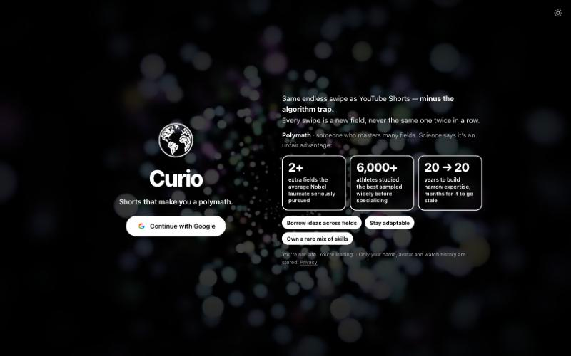

<p align="center">
  <picture>
    <source media="(prefers-color-scheme: dark)" srcset="app-logo.png">
    
  </picture>
</p>

<h1 align="center">Curio</h1>

<p align="center"><strong>Shorts that make you a polymath.</strong><br>The swipe you love — minus the algorithm trap.</p>

<p align="center">
  
</p>

<p align="center">
  
  &nbsp;
  
</p>

<p align="center">
  
</p>

Curio is a Shorts feed without the algorithm trap. A free GitHub Action pulls **trending YouTube Shorts across YouTube's whole topic taxonomy**; the feed jumps to a different topic on every swipe (never the same topic twice in a row, never a repeated video), serving the most-trending unseen video of each topic first. Your **Polymath** radar shows which topics you actually spend time on.

Live: https://k-692.github.io/Curio/

## Stack (100% free tier)

| Layer | Choice | Cost |
| --- | --- | --- |
| Frontend | Preact + TypeScript + Vite, plain CSS | — |
| Hosting | GitHub Pages (Actions deploy) | Free |
| Auth | Firebase Auth — Google sign-in | Free (Spark) |
| Database | Cloud Firestore + Security Rules | Free (Spark quotas) |
| Ingestion | GitHub Actions cron + YouTube Data API | Free |
| Playback | Official YouTube IFrame player / Instagram embed | Free |

The Firebase project stays on the **Spark plan** (no billing account), so it cannot incur charges — when a daily quota is reached, requests simply fail until the next day. Cloud Functions need the paid Blaze plan, so:

- the **discovery engine runs in the browser** against Firestore (the catalogue is public to signed-in users anyway), with all writes guarded by Security Rules;
- **privileged work** (YouTube API key, service account) runs in a scheduled **GitHub Action**, never in the browser.

## How it works

- **Ingestion** (`scripts/ingest`, GitHub Actions, twice a day): YouTube's trending chart + ~40 random topics from YouTube's own topic list per run (most-viewed Shorts of the last 14 days). Each video gets a trending score (views/hour) and its YouTube topic. `meta/topics` lists topics that have videos. Uses ~8,000 of the 10,000 free daily quota units.
- **Feed** (`src/services/engine.ts`, `feed.ts`): shuffled cycle over available topics, no topic twice in a row, excludes queued + recently watched videos, picks the highest-scoring unseen video per topic. Keeps the current video + 10 upcoming; the next 3 are preloaded (buffered, paused).
- **Playback**: starts instantly (muted), sound on as soon as the browser allows; captions off on every video.
- **Share**: the share button opens the phone's share sheet (or copies the link). Links look like `https://k-692.github.io/Curio/v/<youtubeId>` and open that exact video first inside Curio, then continue the feed.
- **Polymath** (`src/services/stats.ts`): seconds actually played per topic; the radar shows topics whose watch time is above your average watch time per video.

## Data model (Firestore)

| Path | Purpose | Access |
| --- | --- | --- |
| `videos/{youtube_id}` | catalogue (`topic`, `topicName`, `score`, `views`, …) | read: signed-in; write: ingestion only |
| `meta/topics` | topics with videos | read: signed-in |
| `users/{uid}/history/{videoId}` | watched history | owner only |
| `users/{uid}/state/feed` | topic cycle, queue, recent ids | owner only |
| `users/{uid}/state/stats` | per-topic seconds, names, videos watched | owner only |

## Development

```bash
npm install
npm run dev        # http://localhost:5173/Curio/
npm test           # engine + URL validation tests
npm run build
```

Deploy rules/indexes: `npx firebase-tools deploy --only firestore`.

## Setup

Repo secrets (already configured): `YOUTUBE_API_KEY` (restricted to YouTube Data API v3) and `FIREBASE_SERVICE_ACCOUNT`. Run **Actions → Ingest YouTube catalogue → Run workflow** to refresh on demand.

## Privacy

Stored per user: Google UID, display name, avatar URL, watched video IDs/titles/timestamps, feed position and pending suggestions. No analytics, likes, follows or interest profiles. Users can remove history entries, clear history, or delete their account and data from the About page.
